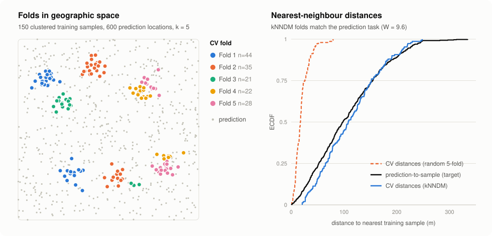

<div align="center">

# knndm

**k-fold Nearest Neighbour Distance Matching cross-validation for Python**

A bit-exact port of [`CAST::knndm`](https://github.com/HannaMeyer/CAST) from R, with optional Rust kernels that run roughly 10–80× faster than the original.

[](LICENSE)
[](pyproject.toml)
[-dea584.svg)](src/)
[](https://doi.org/10.5194/gmd-17-5897-2024)

[Quickstart](#quickstart) · [Usage](#usage) · [How it works](#how-it-works) · [Bit-exactness](#bit-exactness) · [Performance](#performance) · [Citation](#citation)

</div>

<picture>
  <source media="(prefers-color-scheme: dark)" srcset="docs/img/knndm-overview-dark.svg">
  
</picture>

## Why kNNDM?

When training data are spatially clustered, random k-fold cross-validation tests
each model on points that sit right next to its training data. Prediction maps,
however, are made far from the samples, so random CV **overestimates map
accuracy**. kNNDM ([Linnenbrink et al., 2024](https://doi.org/10.5194/gmd-17-5897-2024))
builds k folds whose CV nearest-neighbour distances match the distances between
prediction locations and the training data, so CV error reflects the error you
will actually see in the map.

This package brings the reference implementation from the R package
[CAST](https://github.com/HannaMeyer/CAST) to Python, **reproducing R's output
bit for bit**, so results can be compared and published across both languages.

## Installation

```bash
git clone https://github.com/Geethen/pyKNNDM.git
cd pyKNNDM
pip install .
```

That's it: the pure-Python backend needs only NumPy and SciPy. For large datasets,
optionally build the Rust kernels (identical results, much faster):

| Platform | Command |
|---|---|
| Windows | `pixi run build-rust` (conda-forge Rust + MinGW, no Visual Studio needed) |
| Linux | `cargo build --release && cp target/release/libknndm_rs.so python/knndm/` |
| macOS | `cargo build --release && cp target/release/libknndm_rs.dylib python/knndm/` |

Then reinstall (`pip install .`), or point `KNNDM_RS_LIB` at the built library.
`knndm` picks up the Rust kernels automatically when they are present.

## Quickstart

```python
import numpy as np
from knndm import knndm

rng = np.random.default_rng(42)
centres = rng.uniform(0, 1000, (5, 2))
train_xy = np.vstack([c + rng.normal(0, 30, (40, 2)) for c in centres])  # clustered samples
pred_xy = rng.uniform(0, 1000, (1000, 2))                                 # where you will predict

res = knndm(train_xy, pred_xy, k=5, seed=1)

res.clusters      # fold label (1..k) for each training point
res.indx_train    # list of k arrays of training indices (0-based)
res.indx_test     # list of k arrays of held-out indices (0-based)
res.W             # Wasserstein distance between CV and prediction distances (lower is better)
```

### Use the folds with scikit-learn

The fold indices plug straight into any scikit-learn `cv=` argument:

```python
from sklearn.ensemble import RandomForestRegressor
from sklearn.model_selection import cross_val_score

cv = list(zip(res.indx_train, res.indx_test))
scores = cross_val_score(RandomForestRegressor(), X, y, cv=cv)   # X, y: your predictors and response
```

### Coming from R?

| R (CAST) | Python (knndm) |
|---|---|
| `set.seed(1); knndm(tpoints, predpoints, k = 10)` | `knndm(train_xy, pred_xy, k=10, seed=1)` |
| `knndm(tp, pp, space = "feature", clustering = "kmeans")` | `knndm(train_df, pred_df, space="feature", clustering="kmeans")` |
| `res$indx_train[[1]]` (1-based) | `res.indx_train[0]` (**0-based**) |
| `sf` points | `(n, 2)` array of projected coordinates (`sf::st_coordinates`) |

## Usage

```python
knndm(tpoints, predpoints, space="geographical", k=10, maxp=0.5,
      clustering="hierarchical", linkf="ward.D2", scale_vars=True,
      test_prop=None, test_tolerance=None, nk_len=100,
      seed=None, rng=None, backend="auto")
```

| Argument | Meaning |
|---|---|
| `tpoints`, `predpoints` | Training and prediction locations: `(n, 2)` projected coordinates, or `(n, p)` predictor tables (array or DataFrame) when `space="feature"` |
| `space` | `"geographical"` or `"feature"` |
| `k`, `maxp` | Number of folds, and the maximum share of points allowed in one fold |
| `clustering`, `linkf` | `"hierarchical"` (any `hclust` linkage) or `"kmeans"` |
| `scale_vars` | Standardise predictors in feature space |
| `test_prop`, `test_tolerance` | Make a single train/test split instead of k folds |
| `nk_len` | Number of candidate cluster counts to try |
| `seed` / `rng` | `seed=1` reproduces `set.seed(1)` in R; pass an `RRNG` to carry R's RNG state across calls |
| `backend` | `"auto"` (Rust if built), `"rust"` or `"python"`; all give identical results |

The result is a `KNNDMResult` mirroring CAST's object: `clusters`, `indx_train`,
`indx_test`, `Gij`, `Gj`, `Gjstar`, `W`, `method`, `q` (the chosen number of
clusters), `space` and `messages` (CAST's warnings and notes).

<details>
<summary><b>Feature coverage vs. CAST</b></summary>

| CAST feature | Status |
|---|---|
| `dist_space = "geographical"` (projected coordinates) | ✅ |
| `dist_space = "feature"` (numeric predictors, `scale_vars`) | ✅ |
| `dist_fun = "euclidean"` | ✅ |
| `clustering = "hierarchical"` (every `hclust` linkage) / `"kmeans"` | ✅ |
| `test_prop` / `test_tolerance` train/test split | ✅ |
| Random-CV fallback (when `Gij <= Gj`) | ✅ |
| `predpoints` supplied by the user | ✅ required |
| `modeldomain` sampling, `mahalanobis`, `gower`/categorical, `great_circle` | ❌ not ported |

As in R, rows with missing values in feature space are dropped (noted in
`res.messages`) and the returned indices refer to the remaining rows. When both
feature-space inputs are DataFrames, prediction columns are matched to training
columns by name.

</details>

## How it works

1. **Measure the target.** For every prediction location, find the distance to its
   nearest training sample (`Gij`), and compare with sample-to-sample distances (`Gj`).
   If the samples are already as spread out as the prediction task, random CV is fine
   and is returned.
2. **Cluster the samples.** Cluster the training data (hierarchical or k-means) for a
   range of cluster counts.
3. **Merge clusters into k folds** for each candidate count, and compute the CV
   nearest-neighbour distances `Gjstar` (each held-out point to the training points
   of the other folds).
4. **Pick the best match.** Keep the fold assignment whose `Gjstar` distribution is
   closest to `Gij`, measured by the Wasserstein distance `W`.

For an interactive walkthrough with every intermediate step, its limitations and
ideas for improving it, open [`docs/knndm_explainer.html`](docs/knndm_explainer.html)
in a browser.

## Bit-exactness

For the same inputs and seed, every output (`Gj`, `Gij`, `Gjstar`, `W`, `q`, the
clusters, the fold indices, and R's `.Random.seed` afterwards) is the same IEEE
double or integer as R 4.5.0 + CAST 1.1.2 on x86-64. The test suite checks this
against 40 fixtures generated in R, for both backends.

<details>
<summary><b>How this is achieved</b></summary>

Every numeric step mirrors the code R actually runs (sources in [`reference/native/`](reference/)):

- **RNG:** R's Mersenne-Twister seeding, `unif_rand`, rejection-sampling
  `R_unif_index` and `sample.int`.
- **80-bit long double:** on x86-64, R's `sum`, `cumsum`, `colMeans` and `mean`
  accumulate in x87 80-bit long double. This is emulated exactly, in Python with
  integers and in Rust with a soft-float.
- **Clustering:** `hclust` (Fortran `HCLUST`/`HCASS2`), `cutree` and Hartigan-Wong
  `kmeans` (including its single-precision `1.E30` constant), ported line by line.
- **PCA:** `prcomp` uses a port of R's reference-LAPACK `dgesdd` code path,
  verified bit-exact on ~1,500 matrices.
- **Tests and distances:** `ks.test` (exact/asymptotic, with ties),
  `twosamples::wass_stat`, and FNN / `stats::dist` / GEOS distances, all in R's
  operation order.
- **Fold creation:** `CreateSpacetimeFolds` / `caret::createFolds`, including the
  RNG draws they make.

**Caveat:** with more than 25 predictors, or fewer training points than predictors,
PCA falls back to SciPy's LAPACK. Fold labels could then differ from R in near-tie
cases, and a warning is added to `res.messages`.

</details>

## Performance

Median wall time on a 14-thread laptop (Intel Core Ultra 7 165U), hierarchical clustering.
`W` and `q` are identical to R on every dataset.

| Dataset | R (CAST) | Python | Rust | Speed-up vs. R |
|---|---:|---:|---:|---:|
| 500 points, geographical | 2.0 s | 0.87 s | 0.20 s | **10×** |
| 2,000 points, geographical | 15.6 s | 25.1 s | 0.43 s | **37×** |
| 5,000 points, geographical | 102 s | – | 1.22 s | **84×** |
| 2,000 points, feature space | 29.9 s | 19.4 s | 0.47 s | **64×** |

The Rust kernels have no dependencies and use a plain C ABI loaded with `ctypes`.
They parallelise the neighbour searches and k-means restarts, use exact k-d tree
pruning, and run `hclust` and `cutree` with better asymptotics, all with identical
output. Full results, including k-means: [`bench/RESULTS.md`](bench/RESULTS.md).

## Development

```bash
pip install -e ".[test]"
pytest                                             # R fixtures × both backends + unit tests
Rscript reference/make_fixtures.R tests/fixtures   # regenerate fixtures (needs R, CAST, sf, jsonlite)
```

<details>
<summary>Benchmarks and docs</summary>

The R benchmark scripts read and write relative to `bench/`, so run them from there:

```bash
cd bench
Rscript make_data.R         # writes bench/data/
Rscript bench_r.R           # R timings -> results_r.csv
python bench.py             # Python/Rust timings -> results_py.csv, prints the comparison
```

Regenerate the explainer page with `python docs/make_explainer_data.py --build`
and the README figure with `python docs/make_readme_figure.py`.

</details>

See [CONTRIBUTING.md](CONTRIBUTING.md). The one rule: every change must keep both
backends bit-identical to the R fixtures.

## Citation

If you use kNNDM, please cite the original paper:

> Linnenbrink, J., Milà, C., Ludwig, M., and Meyer, H. (2024). kNNDM CV: k-fold
> nearest-neighbour distance matching cross-validation for map accuracy estimation.
> *Geoscientific Model Development*, 17(15), 5897–5912.
> https://doi.org/10.5194/gmd-17-5897-2024

```bibtex
@article{linnenbrink2024knndm,
  title   = {kNNDM CV: k-fold nearest-neighbour distance matching cross-validation for map accuracy estimation},
  author  = {Linnenbrink, Jan and Mil{\`a}, Carles and Ludwig, Marvin and Meyer, Hanna},
  journal = {Geoscientific Model Development},
  volume  = {17},
  number  = {15},
  pages   = {5897--5912},
  year    = {2024},
  doi     = {10.5194/gmd-17-5897-2024}
}
```

## Acknowledgements

This is an independent port; all credit for the method goes to its authors.

- **[CAST](https://github.com/HannaMeyer/CAST)** by Hanna Meyer and contributors
  ([CRAN](https://CRAN.R-project.org/package=CAST)) is the original R implementation
  that this package reproduces.
- kNNDM builds on NNDM leave-one-out CV by Milà et al. (2022),
  [*Methods in Ecology and Evolution*](https://doi.org/10.1111/2041-210X.13851).
- The port follows the sources of R (`stats`), FNN/ANN, twosamples and reference
  LAPACK, kept in [`reference/native/`](reference/) under their own licenses.

### How this port was built

This port was written largely by AI coding agents, directed and checked by
Geethen Singh. [Claude Code](https://claude.com/claude-code) did the work: Claude
Opus 5.5 translated the R, C and Fortran sources and wrote the Rust kernels, the
tests and the docs, and Claude Sonnet 5.5 made the final repository tidy-ups.
[OpenAI Codex CLI](https://github.com/openai/codex) and Google Antigravity CLI
reviewed the code. Its correctness doesn't rest on the agents: the test suite
compares every output bit for bit with fixtures generated by CAST itself in R.

## License

[GPL-3.0-or-later](LICENSE). This package is a translation of GPL-licensed code
from R, CAST and FNN.
